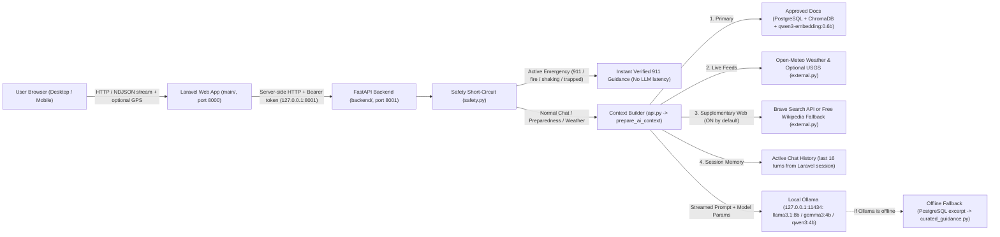

# SANDIG Codebase & Architecture Map (Presentation Reference)

A plain-English reference to every folder and file in this repository: **where the chatbot gets its information**, **what every Python and Laravel file does**, **how streaming, memory, and location work**, and **how to explain the design during a presentation**.

---

## 1. High-Level Architecture (How It Works Today)

---

## 2. Where Does the Chatbot Currently Get Its Information From?

Every non-emergency message goes through `prepare_ai_context()` in [api.py](../backend/sandig/api.py) and is answered live by your **local Ollama AI model** (default **`llama3.1:8b`**, switchable in the UI to `gemma3:4b` or `qwen3:4b`). The backend assembles context in this exact priority order before streaming tokens back to the browser:

| Priority | Information Source | When It Is Used | How It Appears in the UI |
| --- | --- | --- | --- |
| **0 (Override)** | **Deterministic Emergency Guardrail** ([safety.py](../backend/sandig/safety.py)) | Active life-threatening emergencies (`911`, shaking right now, fire, flood, trapped, landslide hitting house). Bypasses the AI model completely for zero latency. | Red **Emergency** alert card with **Call 911** button and curated references. |
| **1 (Primary)** | **Approved Indexed Documents (RAG)** ([rag_chat.py](../backend/sandig/rag_chat.py), [chat_evidence.py](../backend/sandig/chat_evidence.py)) | Whenever approved, active, unexpired documents exist in PostgreSQL + ChromaDB (`.sandig-index/`). Retrieved semantically via `qwen3-embedding:0.6b` (with PostgreSQL keyword fallback). The model is instructed to prioritize these passages and cite them inline as `[1]`, `[2]`. | **Supported by approved sources** card with `Indexed document` citations. |
| **2 (Live Feeds)** | **Open-Meteo Weather & Optional USGS** ([external.py](../backend/sandig/external.py)) | Weather questions fetch live temperature, precipitation, and wind from Open-Meteo (using the user's on-demand browser coordinates if shared, or Baguio City's default coordinates `16.4023, 120.5960`). USGS runs when enabled and explicitly requested. | **Partially supported** card with `Supplementary live feed` citation & `Checked:` timestamp. |
| **3 (Supplementary)** | **Web Search — ON by default** ([external.py](../backend/sandig/external.py)) | Runs on non-greeting prompts unless the user toggles **Web search** to **Off**. Uses **Brave Search API** when `SANDIG_BRAVE_SEARCH_KEY` is configured in root `.env`, or automatically falls back to the **free zero-key Wikipedia API** (`en.wikipedia.org` / `tl.wikipedia.org`). Snippets are given to the model as supplementary context. | Amber **External web search contacted** notice + `External web search` link cards. |
| **4 (Memory)** | **Multi-Turn Conversation History** ([ConversationStore.php](../main/app/Services/ConversationStore.php)) | Up to the last 16 messages of the active chat are forwarded from the Laravel session to Ollama so follow-up questions remember earlier context within the same conversation. | Preserved seamlessly across turns in the active thread. |
| **5 (Base Model)** | **Local LLM Built-In Knowledge** ([rag_chat.py](../backend/sandig/rag_chat.py)) | Always active (via Ollama `llama3.1:8b` or user-selected model) to converse naturally in English or Filipino, synthesize retrieved sources, and answer general questions even before local PDFs/docs are uploaded. When **Web search** is toggled **Off**, the system prompt explicitly instructs the model not to claim online searches or invent URLs. | Model pill (e.g. `llama3.1:8b`) in the header and reply footer. |

### Why Does `curated_guidance.py` Still Exist If the AI Model Answers Directly?
This is a very common presentation question — here is the exact, honest answer:
- **During normal operation (when Ollama is running):** [curated_guidance.py](../backend/sandig/curated_guidance.py) is **not called**. Your local AI model (`llama3.1:8b`) generates the answer live using RAG documents, live weather, web search, and its own knowledge.
- **When Ollama is offline, stopped, or unavailable (graceful degradation):** `fallback_when_ollama_offline()` in [api.py](../backend/sandig/api.py) steps down safely instead of crashing:
  1. Returns live Open-Meteo weather text if it was a weather question.
  2. Returns the top matching approved document excerpt directly from PostgreSQL if one exists.
  3. Checks [curated_guidance.py](../backend/sandig/curated_guidance.py) — which stores compact, source-reviewed English & Filipino baseline guidance for **emergency go-bags** (FEMA Ready) and **landslide preparedness** (USGS) so basic life-safety questions still get a cited, reliable answer **100% offline with zero LLM/GPU needed**.
  4. Otherwise returns a clear message asking the operator to make sure Ollama is running.

---

## 3. Folder Overview

| Folder / File | Purpose | Used at Runtime? |
| --- | --- | --- |
| `main/` | **Laravel 13 frontend** (unified sidebar app shell, live NDJSON streaming UI, LM Studio-style model controls, session memory, on-demand GPS, opt-in Leaflet map, CSRF, rate limiting) | **Yes** (port `8000`) |
| `backend/` | **FastAPI Python backend** (safety guardrail, RAG retrieval, Ollama streaming, live Open-Meteo/USGS/Brave/Wikipedia providers, operator CLI) | **Yes** (port `8001`) |
| `docs/` | Architecture, OpenAPI contract, UX reviews, evaluation data, and step-by-step guides | Reference only |
| `.venv/` | Root Python virtual environment running FastAPI, pytest, and CLI tools | **Yes** (Python runtime) |
| `.env` / `.env.example` | Backend settings (`SANDIG_CHAT_MODEL=llama3.1:8b`, `SANDIG_BRAVE_SEARCH_KEY`, `SANDIG_DATABASE_URL`, `SANDIG_SERVICE_TOKEN`, feature toggles) | **Yes** (`.env` is gitignored) |
| `main/.env` | Laravel settings (`APP_KEY`, `SESSION_DRIVER`, matching `SANDIG_SERVICE_TOKEN`, PostgreSQL config) | **Yes** (gitignored) |
| `.sandig-index/` | Local embedded ChromaDB vector index folder (created when you publish approved documents) | **Yes** (gitignored) |

---

## 4. Every Python File Explained (`backend/sandig/`)

There are **14 Python files** inside `backend/sandig/`. Here is what each one does and whether it runs during live chats:

### A. Active Web Runtime (Runs When Users Chat)

| File | Role in One Sentence | Key Details |
| --- | --- | --- |
| [\_\_init\_\_.py](../backend/sandig/__init__.py) | Marks `sandig` as an importable Python package. | Empty/minimal package marker required so `sandig.api`, `sandig.rag_chat`, etc. can be imported. |
| [api.py](../backend/sandig/api.py) | **Main FastAPI server & orchestrator** (`create_app()`). | Exposes `GET /api/v1/health`, `GET /api/v1/models`, `POST /api/v1/chat/stream` (NDJSON live streaming), `POST /api/v1/chat` (non-streaming), `GET /api/v1/sources`, and `GET /api/v1/locations/barangays`. Enforces Bearer-token auth, validates request schemas (`history`, `model`, `temperature`, `top_p`, `max_tokens`, `num_ctx`, `system_prompt`, `location`), runs `prepare_ai_context()`, streams tokens from Ollama, and runs `fallback_when_ollama_offline()` if Ollama is unreachable. |
| [rag_chat.py](../backend/sandig/rag_chat.py) | **Local AI & Semantic RAG engine** (`RagChatEngine`). | Lists installed Ollama chat models (filtering out embedding models), resolves requested models, performs browser-gated semantic retrieval against ChromaDB + PostgreSQL (`retrieve_semantic`), builds the multi-turn system + history + RAG + weather + web prompt (`build_chat_messages`), configures LM Studio-style options (`build_options`), and streams or completes responses from local Ollama `/api/chat` while stripping `<think>...</think>` reasoning blocks live. |
| [safety.py](../backend/sandig/safety.py) | **Emergency short-circuit & language detector**. | Classifies active life-threatening emergencies (`emergency_text` with immediate 911 / protective guidance in EN/FIL), detects English vs Filipino (`detect_language`), identifies hazard topics (`earthquake`, `landslide`, `flood`, `typhoon`, `fire`), recognizes weather requests (`WEATHER_QUERY`), and matches Baguio barangay names. |
| [external.py](../backend/sandig/external.py) | **Live internet data & web search providers** (`ExternalInformation`). | Handles all outbound internet calls with strict timeouts, caching, and HTTPS URL sanitization: `weather_for(lat, lon)` / `baguio_weather()` (Open-Meteo), `earthquakes()` (optional USGS M2.5+ feed), and `web_search(query, language)` (Brave Search API when `SANDIG_BRAVE_SEARCH_KEY` is set, otherwise free Wikipedia API fallback). |
| [chat_evidence.py](../backend/sandig/chat_evidence.py) | **PostgreSQL keyword RAG fallback** (`find_passages`). | Searches approved, active, browser-eligible document chunks in PostgreSQL using word matching whenever ChromaDB semantic retrieval finds no match or the embedding model is unavailable. |
| [curated_guidance.py](../backend/sandig/curated_guidance.py) | **Offline resilience fallback** (`preparedness_guidance`). | Only triggered if local Ollama is offline (`fallback_when_ollama_offline` in `api.py`). Provides pre-reviewed EN/FIL baseline advice for go-bags (FEMA Ready) and landslide prep (USGS) so core preparedness questions still return safe cited answers without an LLM. |
| [catalog.py](../backend/sandig/catalog.py) | **PostgreSQL schema & source catalog validation**. | Defines the `sources` and `document_chunks` database tables, Pydantic `Manifest` / `Source` schemas, HTTPS URL validation, and cursor-paginated queries backing `/api/v1/sources`. |
| [locations.py](../backend/sandig/locations.py) + [baguio_barangays.tsv](../backend/sandig/baguio_barangays.tsv) | **Official Baguio barangay roster**. | Loads the official PSA list of 129 Baguio City barangays (`2025-07-31`) used to recognize local place names in prompts and serve `/api/v1/locations/barangays`. |

### B. Operator CLI, Document Ingestion & Evaluation Tools (Run Manually in Terminal — Not Web Routes)

| File | Role in One Sentence | How You Run It |
| --- | --- | --- |
| [operator_wizard.py](../backend/sandig/operator_wizard.py) | **Interactive terminal wizard for operators**. | `.\.venv\Scripts\python.exe -m sandig.operator_wizard` — guided menu to add/publish documents, edit `.env` settings, list/deactivate sources, and initialize PostgreSQL. |
| [source_cli.py](../backend/sandig/source_cli.py) | **Scriptable document catalog CLI**. | `.\.venv\Scripts\python.exe -m sandig.source_cli <init\|stage\|inspect\|publish\|reindex\|deactivate\|cleanup\|retrieve>` — manages document lifecycle and opens the local ChromaDB collection (`open_collection`). |
| [rag.py](../backend/sandig/rag.py) | **Document chunking, hashing & vector indexing library**. | Splits `.txt`/`.md` files into chunks, hashes files with SHA-256, generates vector embeddings via `OllamaEmbedder` (`qwen3-embedding:0.6b`), and writes/cleans up ChromaDB + PostgreSQL records. |
| [smoke.py](../backend/sandig/smoke.py) | **Quick health-check utility for PostgreSQL & Ollama**. | `.\.venv\Scripts\python.exe -m sandig.smoke` — verifies database and Ollama connectivity during setup or troubleshooting. |
| [benchmark.py](../backend/sandig/benchmark.py) | **Offline model comparison script**. | Evaluates local Ollama models side-by-side (used earlier to generate `docs/evaluation-runs/phase-7-local.json`). |

### C. Backend Automated Tests (`backend/tests/` — 82 Passed, 3 Skipped)
- `test_api.py` — Bearer auth, OpenAPI contract parity, instant emergency short-circuits, barangay handling, and DB outage fallbacks.
- `test_external.py` — Streaming NDJSON tokens + memory + model parameters, Brave Search & free Wikipedia fallback, web-search-off behavior, browser GPS → Open-Meteo weather, and USGS filtering.
- `test_rag_chat.py` — Model listing, semantic retrieval publication gates (language, jurisdiction, hazard, active/approved status), grounded RAG answers, and Ollama failure handling.
- `test_rag.py` — Document chunking, staging, publishing, expiration, vector retrieval, and cleanup.
- `test_operator_wizard.py` — Interactive wizard manifest validation, `.env` editing, and secret masking.
- `test_benchmark.py`, `test_smoke.py` — Benchmark runner and smoke-check tests.

---

## 5. Frontend Files (`main/` — Laravel 13 + Vite + Tailwind + Leaflet)

### Active Application Code
| File | What It Does |
| --- | --- |
| [web.php](../main/routes/web.php) | Web routes: `GET /` (chat), `POST /chat` (non-JS fallback submit), `POST /chat/stream` (live NDJSON streaming), `GET /chats/{id}` (switch chat), `DELETE /chats/{id}` & `DELETE /chats` (delete), `POST /settings` (LM Studio model & parameter settings), `GET /sources` (approved sources catalog). |
| [ChatController.php](../main/app/Http/Controllers/ChatController.php) | Server-side bridge to FastAPI: fetches installed Ollama models (`GET /api/v1/models`), forwards conversation memory (`history`), model settings, web toggle, and single-request GPS `location`; proxies live NDJSON tokens from `/api/v1/chat/stream`; validates all citations & HTTPS links; persists completed turns to the user's session. |
| [SourceCatalogController.php](../main/app/Http/Controllers/SourceCatalogController.php) | Read-only viewer for `/api/v1/sources` with cursor pagination, HTTPS-only URL enforcement, and session `Recent chats` passed into the unified sidebar. |
| [ConversationStore.php](../main/app/Services/ConversationStore.php) | Session-scoped multi-chat & settings manager: stores bounded chat history (max 10 chats, 20 messages each, 24h TTL), formats the last 16 turns for LLM memory (`historyForApi`), stores LM Studio parameters (`model`, `temperature`, `top_p`, `max_tokens`, `num_ctx`, `system_prompt`, `detail`, `web_off`), and strictly strips raw GPS coordinates so location is never saved. |
| [chat.blade.php](../main/resources/views/chat.blade.php) | Main chat workspace: persistent sidebar with **Recent chats**, **Approved sources**, **Model & settings** (LM Studio-style model picker, sliders, context/tokens, optional system prompt), **Web search On/Off** switch (ON by default), opt-in Location & Leaflet map panel, and streaming thread. |
| [sources.blade.php](../main/resources/views/sources.blade.php) & [components/layout.blade.php](../main/resources/views/components/layout.blade.php) | Approved Sources catalog wrapped in the **exact same unified sidebar app shell** as the chat page (SANDIG brand, New chat, Recent chats, highlighted Approved sources nav, Emergency 911 card, and slim top header). |
| [components/icon.blade.php](../main/resources/views/components/icon.blade.php) | Inline SVG icon library (zero external icon CDNs). |
| [app.js](../main/resources/js/app.js) | Client-side chat UX: live NDJSON token streaming, real-time **Recent chats** sidebar updates (title, `"just now"`, active highlight, delete button), on-demand browser geolocation prompt for location-dependent queries, Web search On/Off sync, LM Studio slider readouts, smart auto-scroll, citation badges, Copy answer, and opt-in Leaflet OpenStreetMap reference map. |
| [sources.js](../main/resources/js/sources.js) | Approved Sources UX: accessible mobile sidebar drawer (`#drawer-toggle`, `Escape`), delete-chat confirmation, and instant client-side search & hazard filtering. |
| [app.css](../main/resources/css/app.css) & [services.php](../main/config/services.php) | Tailwind CSS v4 styles (compiled via Vite into `main/public/build/`) and `SANDIG_SERVICE_TOKEN` config loader. |

### Frontend Automated Tests (`main/tests/Feature/` — 68 Passed, 580 Assertions)
- `ChatTest.php` — Shell rendering, live `/chat/stream` NDJSON proxy, real-time conversation metadata, multi-turn `history` memory, LM Studio parameter saving/forwarding, Web search On/Off enforcement, single-request GPS forwarding without persistence, emergency alerts, XSS escaping, HTTPS-only citations, session isolation, and rate limiting.
- `SourceCatalogTest.php` — Unified sidebar shell & session chats display, catalog pagination validation, XSS escaping, outage fallbacks, and rate limits.

*(Note: `main/app/Models/User.php`, `main/resources/views/welcome.blade.php`, and `ExampleTest.php` are untouched default Laravel skeleton files.)*

---

## 6. Presentation Q&A Cheat Sheet

- **"Is this RAG or fine-tuning?"**
  It is **local RAG + live tool context** on top of an off-the-shelf local 8B model (`llama3.1:8b` via Ollama) — **not fine-tuning**. Updating knowledge only requires publishing a new approved document into PostgreSQL + ChromaDB (no retraining).
- **"Where does the chatbot pull its answers from right now?"**
  In priority order: **(1)** Approved local RAG documents when uploaded/published, **(2)** Live Open-Meteo weather / optional USGS feeds, **(3)** Supplementary web search (Brave Search API if key set, otherwise free Wikipedia fallback — ON by default and toggleable Off), **(4)** Your active chat's conversation memory (last 16 turns), and **(5)** `llama3.1:8b`'s own built-in knowledge. Active life-threatening emergencies bypass the LLM entirely via `safety.py` for instant `911` guidance.
- **"Why do we have `curated_guidance.py` if the model generates answers?"**
  It is an **offline resilience fallback** (`fallback_when_ollama_offline`). During normal use, `llama3.1:8b` answers directly and `curated_guidance.py` isn't touched. If Ollama is stopped or crashes, SANDIG degrades gracefully to PostgreSQL excerpts and `curated_guidance.py`'s pre-reviewed FEMA/USGS go-bag and landslide guidance instead of failing completely.
- **"How is user privacy handled?"**
  Chats live only in the user's server-side Laravel session (bounded to 10 chats / 20 messages / 24h) and are sent only to your **local** Ollama instance. Browser GPS is requested on-demand only when a prompt asks for local context (e.g. *"weather near me"*), sent for that single request, and **never stored** in chat history.
- **"How tested is the system?"**
  **150 passing automated tests** (82 backend `pytest` + 68 frontend Laravel `Pest` with 580 assertions) covering streaming, memory, RAG gating, safety guardrails, XSS escaping, HTTPS-only citations, and rate limits.
- **"What is intentionally deferred for later?"**
  Phase 6 GIS hazard-zone polygon imports (waiting on validated official Baguio QGIS datasets & reuse permissions), machine-readable PHIVOLCS/PAGASA official alert APIs (direct official portal links are provided instead), and public cloud deployment.
